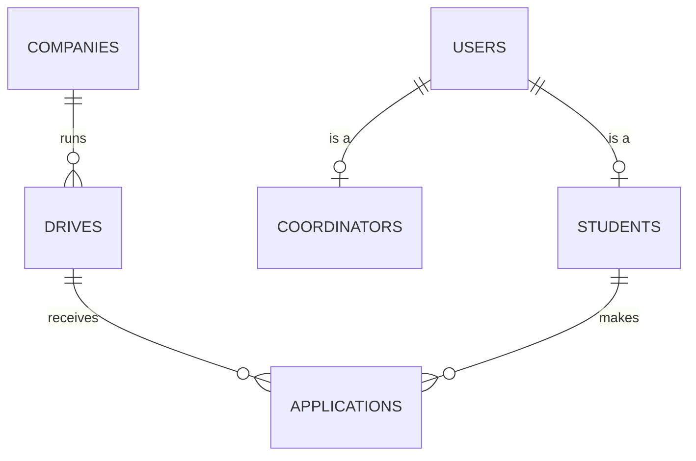

# PlaceTrack Study Guide

Everything about the project in one place, in simple words: the structure, every class, every entity, the main
flows and every concept you can be asked about in the viva.

How to use this guide:
1. Read sections 1–3 first (10 minutes): the big picture.
2. Read sections 4–9 with the code open next to you: one layer at a time.
3. Read section 11 (concepts) until you can explain each one in two sentences.
4. Test yourself with section 13.

---

## Contents

1. [What PlaceTrack does](#1-what-placetrack-does)
2. [The big picture](#2-the-big-picture)
3. [Project structure (every file)](#3-project-structure-every-file)
4. [Entities: the data](#4-entities-the-data)
5. [Repositories: talking to the database](#5-repositories-talking-to-the-database)
6. [Services: the business rules](#6-services-the-business-rules)
7. [Controllers and pages](#7-controllers-and-pages)
8. [The REST API](#8-the-rest-api)
9. [The eligibility microservice](#9-the-eligibility-microservice)
10. [The supporting classes](#10-the-supporting-classes)
11. [Concepts explained simply](#11-concepts-explained-simply)
12. [Annotation cheat sheet](#12-annotation-cheat-sheet)
13. [Self-test questions](#13-self-test-questions)

---

## 1. What PlaceTrack does

PlaceTrack is a **campus placement tracker**. A **placement drive** is one company hiring for one job at the college.

| Who | What they can do |
| --- | --- |
| **Coordinator** (placement staff) | Manage companies; create drives with rules (minimum CGPA, maximum backlogs, allowed departments, deadline); see applicants; shortlist, select or reject them; see a dashboard |
| **Student** | Register; see open drives; check "Am I eligible?"; apply; see and withdraw applications; edit their profile |
| **Other programs** (Postman) | Use the REST API (JSON) |

The special part: **eligibility is decided by a second, separate application** (a microservice) on its own port.

---

## 2. The big picture

### 2.1 Two applications

```text
 Browser ──HTML──►┌──────────── placetrack-app (port 8080) ────────────┐
 Postman ──JSON──►│ Controllers → Services → Repositories → H2 database │
                  │                  │                                  │
                  │          EligibilityClient ────────────────────────────► eligibility-service (port 8082)
                  └─────────────────────────────────────────────────────┘     3 rules, no database
```

- **placetrack-app**: the main website. It owns all the data and all the pages.
- **eligibility-service**: a tiny app that only answers "is this student eligible for this drive?".
- They share **no Java code**. They only agree on a URL and a JSON shape.

### 2.2 The layers inside the main app (the "office" picture)

| Layer | Package | Job | Office analogy |
| --- | --- | --- | --- |
| View | `templates/` | HTML pages | The form you fill in at the counter |
| Controller | `controller/`, `api/` | Receives the request, calls a service, picks the page or returns JSON | Receptionist |
| Service | `service/` | Business rules ("deadline passed?") | Officer who decides |
| Repository | `repository/` | Reads and writes the database | Clerk at the filing cabinet |
| Entity | `model/` | One Java class = one table | A file in the cabinet |
| Database | H2 (`data/` folder) | Stores the rows | The filing cabinet |

Rule: **controllers never touch repositories directly**; they always go through a service.

### 2.3 One request from start to end: a student clicks **Apply**

1. The browser sends `POST /student/drives/2/apply`.
2. **LoginInterceptor** checks: logged in? Role STUDENT? Yes, continue.
3. **StudentController.apply()** gets the logged-in student from the session.
4. The call goes through two **proxies** Spring put around the service: the **AOP audit aspect** (starts a timer) and
   the **transaction** (begins a database transaction).
5. **ApplicationService.apply()** checks the rules in order:
   placed? → deadline passed? → already applied? → asks the **eligibility microservice** (CGPA, backlogs, department).
6. All good: it saves an `Application` with status APPLIED. The transaction **commits**.
   Any rule fails: it throws an exception, the transaction **rolls back**, nothing is saved.
7. The aspect prints `AUDIT apply ... outcome=SUCCESS` (or BLOCKED).
8. The controller **redirects** to "My applications" with the message "Applied successfully"
   (or back to the drive with the reasons).

---

## 3. Project structure (every file)

```text
placetrack2/
├── README.md                 how to run, use and develop
├── docs/                     PLAN.md, m1.md, m2.md, m3.md, team.md, this guide, report/ (schema SQL), screenshots/
├── postman/                  Postman collection + environment
│
├── eligibility-service/      SECOND APP, port 8082
│   ├── pom.xml               Maven: Spring web + validation + test
│   └── src/main/java/com/placetrack/eligibility/
│       ├── EligibilityServiceApplication   main(): starts the service
│       ├── EligibilityController           POST /eligibility/check, GET /eligibility/ping
│       ├── EligibilityService              the 3 rules
│       ├── EligibilityRequest              JSON in  (student marks + drive criteria)
│       └── EligibilityResponse             JSON out (eligible + reasons)
│
└── placetrack-app/           MAIN APP, port 8080
    ├── pom.xml               Maven: web, Thymeleaf, JPA, validation, AOP, BCrypt, H2, test
    └── src/main/
        ├── java/com/placetrack/
        │   ├── PlacetrackApplication     main(): starts the app
        │   │
        │   ├── model/                    ENTITIES (tables)
        │   │   ├── User                  abstract parent: id, name, email, password hash
        │   │   ├── Student               extends User: regNo, department, cgpa, backlogs, placed
        │   │   ├── Coordinator           extends User: staffId
        │   │   ├── Company               name, sector
        │   │   ├── Drive                 company, role, package, criteria, deadline
        │   │   ├── Application           student + drive + status + date
        │   │   └── ApplicationStatus     enum: APPLIED, SHORTLISTED, SELECTED, REJECTED, WITHDRAWN
        │   │
        │   ├── repository/               DATABASE ACCESS (interfaces, Spring writes the code)
        │   │   ├── UserRepository        find by email (login)
        │   │   ├── StudentRepository     reg-no check, placed count
        │   │   ├── CompanyRepository     duplicate-name check
        │   │   ├── DriveRepository       open drives (HQL), drives per company
        │   │   └── ApplicationRepository duplicates, my applications, applicants, counts per drive
        │   │
        │   ├── service/                  BUSINESS RULES
        │   │   ├── CompanyService        company CRUD + rules
        │   │   ├── DriveService          drive CRUD + open drives + counts
        │   │   ├── AuthService           login + registration
        │   │   ├── ApplicationService    apply, check, withdraw, applicants, status changes
        │   │   └── StudentService        profile + dashboard counts
        │   │
        │   ├── controller/               WEB PAGES (MVC)
        │   │   ├── AuthController        /, /login, /logout, /register
        │   │   ├── CompanyController     /coordinator/companies/...
        │   │   ├── DriveController       /coordinator/drives/...
        │   │   ├── ApplicantController   applicants + status buttons
        │   │   ├── DashboardController   /coordinator/dashboard
        │   │   ├── StudentController     /student/drives/..., /student/applications/...
        │   │   └── ProfileController     /student/profile
        │   │
        │   ├── api/                      REST API (JSON)
        │   │   ├── ApiController         5 endpoints under /api
        │   │   ├── ApiErrorHandler       exceptions → JSON errors
        │   │   └── ApplyRequest          JSON body {studentId, driveId}
        │   │
        │   ├── client/                   CALLING THE MICROSERVICE
        │   │   ├── EligibilityClient     RestTemplate call with timeouts
        │   │   └── EligibilityResult     the reply {eligible, reasons}
        │   │
        │   ├── aspect/
        │   │   └── ApplyAuditAspect      AOP: logs every apply attempt
        │   │
        │   ├── exception/
        │   │   ├── ApplyException                    a rule refused the action
        │   │   └── EligibilityUnavailableException   microservice down or slow
        │   │
        │   ├── config/
        │   │   ├── AppConfig             PasswordEncoder bean + registers the interceptor
        │   │   ├── LoginInterceptor      login/role check before student and coordinator pages
        │   │   ├── SessionUser           who is logged in (stored in the session)
        │   │   └── DataSeeder            demo data on first start
        │   │
        │   └── demo/
        │       ├── HibernateSessionDemo  SessionFactory / Session / Transaction with rollback
        │       └── BeanFactoryDemo       BeanFactory (lazy) vs ApplicationContext (eager)
        │
        └── resources/
            ├── application.properties    port, database, Hibernate, eligibility URL
            ├── static/css/app.css        our colours and fonts on top of Bootstrap
            └── templates/                Thymeleaf pages
                ├── fragments/layout.html shared head, navbar, messages, status badge
                ├── login, register, error
                ├── coordinator/          dashboard, companies, company-form, drives, drive-form, applicants
                └── student/              drives, drive-detail, applications, profile
```

Tests live in `src/test/java/...` (section 10.6).

---

## 4. Entities: the data

An **entity** is a Java class marked `@Entity`. Hibernate turns it into a **table**; each object is a **row**;
each field is a **column**.

### 4.1 The tables and how they connect



In words:
- A **User** is either a **Student** or a **Coordinator** (inheritance).
- One **Company** runs many **Drives**.
- One **Student** makes many **Applications**; one **Drive** receives many **Applications**.
- So an **Application** is the link between a student and a drive, plus a status and a date.

### 4.2 Each entity

**User** (abstract, table `users`): the shared part of every account
| Field | Type | Rules / notes |
| --- | --- | --- |
| `id` | Long | Primary key, auto-numbered (IDENTITY) |
| `fullName` | String | Required |
| `email` | String | Required, valid email, **unique** (login name) |
| `password` | String | **BCrypt hash**, never plain text; `@JsonIgnore` hides it from JSON |

`abstract` means you never create a plain `User`; you create a `Student` or a `Coordinator`.

**Student** (table `students`), extends User
| Field | Type | Rules / notes |
| --- | --- | --- |
| `regNo` | String | Required, **unique** |
| `department` | String | One of CSE, IT, ECE, EEE, MECH, CIVIL, AIDS |
| `cgpa` | double | 0 to 10 |
| `backlogs` | int | 0 or more |
| `placed` | boolean | Becomes true when a coordinator SELECTs the student |

**Coordinator** (table `coordinators`), extends User
| Field | Type | Rules |
| --- | --- | --- |
| `staffId` | String | **unique** |

**Company** (table `companies`)
| Field | Type | Rules |
| --- | --- | --- |
| `id` | Long | Auto-numbered |
| `name` | String | Required, max 100, **unique** |
| `sector` | String | Optional |

**Drive** (table `drives`)
| Field | Type | Rules / notes |
| --- | --- | --- |
| `id` | Long | Auto-numbered |
| `company` | Company | `@ManyToOne`: column `company_id` (foreign key) |
| `roleTitle` | String | Required, e.g. "Cloud Engineer" |
| `packageLpa` | double | Salary in lakhs per year, at least 0.1 |
| `minCgpa` | double | Eligibility rule, 0–10 |
| `maxBacklogs` | int | Eligibility rule, 0 or more |
| `allowedDepartments` | String | Comma-separated, e.g. `"CSE,IT"` |
| `deadline` | LocalDate | Required |

Helper methods (not columns): `getDepartmentList()` turns `"CSE,IT"` into a list; `isOpen()` is true while the
deadline is today or later. `DEPARTMENTS` is the fixed list used in forms.

**Application** (table `applications`)
| Field | Type | Rules / notes |
| --- | --- | --- |
| `id` | Long | Auto-numbered |
| `student` | Student | `@ManyToOne`: column `student_id` |
| `drive` | Drive | `@ManyToOne`: column `drive_id` |
| `status` | ApplicationStatus | Stored as text (`"APPLIED"`) |
| `appliedAt` | LocalDateTime | Set to "now" when created |

Unique pair (`student_id`, `drive_id`): the database itself refuses a second application to the same drive.

**ApplicationStatus** (enum, not a table)
```text
APPLIED ──► SHORTLISTED ──► SELECTED  (also sets student.placed = true)
   │             │
   ├──► REJECTED ◄┘                     (coordinator)
   └──► WITHDRAWN  (also from SHORTLISTED; student only)
```
SELECTED, REJECTED and WITHDRAWN are final.

### 4.3 Inheritance (JOINED)

`@Inheritance(strategy = InheritanceType.JOINED)` on `User`:
- Shared fields go in `users`; Student-only fields in `students`; Coordinator-only fields in `coordinators`.
- A student is **two rows** with the **same id**: one in `users`, one in `students`.
- Reading a student makes Hibernate **join** the two tables.
- Why JOINED: no empty columns, each table is clean. (SINGLE_TABLE = one big table with many empty columns.
  TABLE_PER_CLASS = full copies of the shared columns in every child table.)

### 4.4 Seed data (created by `DataSeeder` on an empty database)

2 coordinators, 6 students (`student3` already placed), 5 companies (Helio Power has no drives), 5 drives (one
already closed), 4 applications. Every password is `Pass@123`.

---

## 5. Repositories: talking to the database

A repository is an **interface**. You only declare methods; Spring Data JPA writes the code at startup.
Extending `JpaRepository<Entity, Long>` gives you these for free: `save`, `findById`, `findAll`, `deleteById`,
`count` (that is the **CRUD**).

Two ways to add more queries:
- **Derived query**: Spring reads the method name. `existsByEmail(email)` becomes
  `select ... where email = ?`.
- **HQL query** with `@Query`: you write the query yourself using **class and field names** (not table names).

| Repository | Method | Kind | What it returns | Used by |
| --- | --- | --- | --- | --- |
| UserRepository | `findByEmail` | derived | the user with that email | login |
| UserRepository | `existsByEmail` | derived | is the email taken? | register |
| StudentRepository | `existsByRegNo` | derived | is the reg no taken? | register |
| StudentRepository | `countByPlacedTrue` | derived | number of placed students | dashboard |
| CompanyRepository | `findByNameIgnoreCase` | derived | company with that name | duplicate check |
| DriveRepository | `findOpenDrives(today)` | **HQL** | drives with deadline ≥ today | student list, API |
| DriveRepository | `countByCompanyId` | derived | drives of a company | delete rule |
| ApplicationRepository | `existsByStudentIdAndDriveId` | derived | already applied? | apply rule |
| ApplicationRepository | `countByDriveId` | derived | applications of a drive | delete rule |
| ApplicationRepository | `findByStudent` | **HQL** | a student's applications, newest first | My applications, API |
| ApplicationRepository | `findApplicantsOfDrive` | **HQL + join fetch** | applicants with their student, best CGPA first | applicants page |
| ApplicationRepository | `countApplicationsPerDrive` | **HQL GROUP BY + left join** | rows `[company, role, count]` | dashboard |

Example HQL: `select d from Drive d where d.deadline >= :today order by d.deadline`
(`Drive` and `deadline` are the Java class and field; `:today` is a parameter.)

---

## 6. Services: the business rules

A service is a Spring bean (`@Service`) that holds the rules. Controllers call services; services call repositories.

### CompanyService
| Method | Does |
| --- | --- |
| `findAll()` | all companies, by name |
| `getById(id)` | one company, or **404** |
| `save(company)` | create or update; **refuses a duplicate name** |
| `delete(id)` | **refuses if the company has drives** |

### DriveService
| Method | Does |
| --- | --- |
| `findAll()` | all drives, nearest deadline first |
| `findOpenDrives()` | drives with deadline today or later |
| `getById(id)` | one drive, or 404 |
| `save(drive)` | create or update |
| `applicationCounts()` | rows for the dashboard table |
| `delete(id)` | **refuses if the drive has applications** |

### AuthService
| Method | Does |
| --- | --- |
| `login(email, password)` | finds the user, checks the password with BCrypt, returns a `SessionUser` (or empty) |
| `register(student, rawPassword)` | password ≥ 6 characters, email and reg no not taken, hashes the password, saves |

### ApplicationService (the heart)
| Method | Does |
| --- | --- |
| `apply(studentId, driveId)` `@Transactional` | rules in order: not placed → deadline not passed → not already applied → eligibility service says yes → save APPLIED |
| `checkEligibility(studentId, driveId)` | only asks the eligibility service; saves nothing |
| `myApplications(studentId)` | the student's applications |
| `withdraw(applicationId, studentId)` `@Transactional` | own application only; only from APPLIED or SHORTLISTED |
| `applicantsOfDrive(driveId)` | for the applicants page |
| `updateStatus(applicationId, next)` `@Transactional` | APPLIED → SHORTLISTED/REJECTED, SHORTLISTED → SELECTED/REJECTED; SELECTED also sets `placed = true` in the same transaction |

### StudentService
| Method | Does |
| --- | --- |
| `getById(id)`, `save(student)` | for the profile page |
| `countStudents()`, `countPlaced()` | for the dashboard |

### Business rules summary
| Rule | Where |
| --- | --- |
| CGPA ≥ minimum, backlogs ≤ maximum, department allowed | eligibility-service |
| Deadline not passed | ApplicationService.apply |
| One application per student per drive | ApplicationService.apply + unique constraint |
| Placed students cannot apply | ApplicationService.apply |
| Allowed status moves; SELECTED ⇒ placed | ApplicationService.updateStatus |
| Withdraw only own, only from APPLIED/SHORTLISTED | ApplicationService.withdraw |
| Company names unique; company with drives not deletable | CompanyService |
| Drive with applications not deletable | DriveService |

---

## 7. Controllers and pages

A controller (`@Controller`) method handles one URL, puts data into the **Model**, and returns a **template name**.
Thymeleaf fills that template with the model data and sends HTML back.

| Controller | URL | Page / result | Who |
| --- | --- | --- | --- |
| AuthController | `GET /` | redirect: student → drives, coordinator → dashboard, guest → login | anyone |
| | `GET/POST /login` | login form / log in | anyone |
| | `POST /logout` | log out | logged in |
| | `GET/POST /register` | student sign-up | anyone |
| CompanyController | `/coordinator/companies` (+ `/new`, `/{id}/edit`, POST save, `/{id}/delete`) | company list and form | coordinator |
| DriveController | `/coordinator/drives` (+ `/new`, `/{id}/edit`, POST save, `/{id}/delete`) | drive list and form | coordinator |
| ApplicantController | `GET /coordinator/drives/{id}/applicants`, `POST /coordinator/applications/{id}/status` | applicants, status buttons | coordinator |
| DashboardController | `GET /coordinator/dashboard` | counts + applications per drive | coordinator |
| StudentController | `/student/drives`, `/student/drives/{id}`, `/{id}/check`, `POST /{id}/apply`, `/student/applications`, `POST .../withdraw` | student pages | student |
| ProfileController | `GET/POST /student/profile` | profile | student |

**Pattern used in every form (Post-Redirect-Get):**
1. `GET` shows the form.
2. `POST` saves. If validation fails, show the form again with red messages.
3. On success, **redirect** to a list page with a green **flash message**.
So pressing Refresh never submits the form twice.

**Templates** (`resources/templates/`):
- `fragments/layout.html` has the shared parts: `head`, `nav` (links depend on the role), `flash` (messages),
  `statusBadge` (coloured status).
- Thymeleaf basics: `th:text="${x}"` prints a value, `th:each` repeats, `th:if` shows conditionally,
  `th:object` + `th:field="*{name}"` bind a form to an object, `th:errors` shows validation messages,
  `@{/path}` builds a link, `th:replace` inserts a fragment.
- `static/css/app.css` sets our colours and font on top of Bootstrap.

---

## 8. The REST API

`ApiController` is a `@RestController`: it returns **JSON**, not HTML. It reuses the same services as the pages,
so the same rules apply.

| Method + path | Body | Success | Errors |
| --- | --- | --- | --- |
| `GET /api/drives` | – | 200 list of open drives | – |
| `GET /api/drives/{id}` | – | 200 one drive | 404 |
| `POST /api/companies` | `{"name","sector"}` | 201 the company | 400 |
| `POST /api/applications` | `{"studentId","driveId"}` | 201 the application | 400 with `error` + `reasons`, 404, 503 |
| `GET /api/students/{id}/applications` | – | 200 list | – |

`ApiErrorHandler` turns exceptions into JSON:
| Exception | Status |
| --- | --- |
| `ApplyException` (rule failed) | 400 + reasons |
| `IllegalArgumentException` (e.g. duplicate company) | 400 |
| Validation failed (`@Valid`) | 400 + which fields |
| `ResponseStatusException` (not found) | 404 |
| `EligibilityUnavailableException` | 503 |

Known shortcut: the API has **no login** (easy Postman testing). A real system would use the session or a JWT.

---

## 9. The eligibility microservice

Five small classes in `eligibility-service`:

| Class | Job |
| --- | --- |
| `EligibilityServiceApplication` | `main()`: starts it on port 8082 |
| `EligibilityController` | `POST /eligibility/check` (with `@Valid`), `GET /eligibility/ping` |
| `EligibilityService` | 3 rules: CGPA ≥ minimum, backlogs ≤ limit, department in list; one reason per failure |
| `EligibilityRequest` | the JSON input (record with validation) |
| `EligibilityResponse` | the JSON output `{eligible, reasons}` |

Example:
```json
IN : { "cgpa": 7.2, "backlogs": 1, "department": "IT",
       "minCgpa": 7.5, "maxBacklogs": 0, "allowedDepartments": ["IT", "CSE"] }
OUT: { "eligible": false,
       "reasons": ["CGPA 7.2 is below the required 7.5", "Backlogs 1 exceed the limit of 0"] }
```

The main app calls it through **EligibilityClient** (`RestTemplate`, 2 s connect and 3 s read timeouts). If it is
down or slow, the client throws `EligibilityUnavailableException` and the student sees
"Eligibility check unavailable, try later". Nothing is saved.

---

## 10. The supporting classes

### 10.1 config/
| Class | Job |
| --- | --- |
| `AppConfig` | creates the `PasswordEncoder` (BCrypt) bean; registers `LoginInterceptor` for `/student/**` and `/coordinator/**` |
| `LoginInterceptor` | before those pages: no user → `/login`; wrong role → 403 |
| `SessionUser` | record `(id, name, role)` stored in the session at login |
| `DataSeeder` | `CommandLineRunner`: fills an empty database with demo data at startup |

### 10.2 client/
`EligibilityClient` (calls the microservice) and `EligibilityResult` (its reply, a **copy** of the service's class:
microservices never share Java code).

### 10.3 aspect/
`ApplyAuditAspect`: an `@Around` advice on `ApplicationService.apply(..)`. Times every call and logs
`AUDIT apply student=3 drive=2 outcome=SUCCESS time=292ms` or `BLOCKED reason=...`. The service itself has no
logging code.

### 10.4 exception/
`ApplyException` (a rule refused; may carry the eligibility reasons) and `EligibilityUnavailableException`
(service down). Both are `RuntimeException`s, so `@Transactional` rolls back automatically.

### 10.5 demo/
| Class | Shows | Run |
| --- | --- | --- |
| `HibernateSessionDemo` | SessionFactory → Session → Transaction; inserts a company, **rolls back**, proves it is gone (5 → 6 → 5) | `./mvnw spring-boot:run -Dspring-boot.run.profiles=demo` |
| `BeanFactoryDemo` | BeanFactory creates a bean only when asked; ApplicationContext creates it at startup and injects it | run its `main` in the IDE |

### 10.6 Tests (31 in total)
| Test class | Kind | Checks |
| --- | --- | --- |
| `EligibilityServiceTest` (5) | plain JUnit | the 3 rules |
| `EligibilityControllerTest` (2) | `@WebMvcTest` | 200 for good JSON, 400 for missing field |
| `RepositoryTest` (4) | `@DataJpaTest` | the HQL queries |
| `PlacetrackAppTests` (2) | `@SpringBootTest` | the app starts, seed data, inheritance |
| `ApplicationServiceTest` (8) | Mockito | apply and withdraw rules |
| `StatusUpdateTest` (4) | Mockito | status moves, SELECTED ⇒ placed |
| `ApiControllerTest` (6) | `@WebMvcTest` + `@MockitoBean` | API status codes and JSON |

---

## 11. Concepts explained simply

### Spring and Spring Boot
| Concept | Simple meaning | In PlaceTrack |
| --- | --- | --- |
| **Spring Boot** | Spring with sensible defaults: add a "starter" to `pom.xml` and it configures itself; has a built-in web server | `@SpringBootApplication` + `main()` |
| **Bean** | An object Spring creates and manages | every `@Service`, `@Controller`, `@Component`, `@Bean` |
| **IoC (Inversion of Control)** | Spring creates and connects your objects, not you | you never write `new ApplicationService(...)` |
| **Dependency Injection (DI)** | A class asks for what it needs in its constructor; Spring passes it in | every constructor in services and controllers |
| **ApplicationContext** | Spring's full container: creates beans at startup, supports annotations, AOP, events | created by Spring Boot |
| **BeanFactory** | The basic container: creates a bean only when asked | `BeanFactoryDemo` |
| **Bean scopes** | singleton (one shared, default), prototype (new each time), request, session | all ours are singletons |
| **Profile** | A switch to turn beans on or off | `HibernateSessionDemo` only runs with `demo` |
| **application.properties** | Settings file: port, database, custom values | `eligibility.url` read with `@Value` |

### Web (MVC)
| Concept | Simple meaning |
| --- | --- |
| **MVC** | Model (data) + View (HTML page) + Controller (code that handles the request) |
| **DispatcherServlet** | Spring's front desk: every request arrives here and is sent to the right controller method |
| **Thymeleaf** | HTML templates with placeholders that Spring fills in |
| **Session** | Memory on the server per browser, linked by the `JSESSIONID` cookie; holds the logged-in user |
| **Interceptor** | Code that runs before controllers (our login/role check) |
| **Post-Redirect-Get** | After a POST, redirect, so Refresh does not resubmit |
| **Flash attribute** | A message that survives exactly one redirect |
| **Bean Validation** | Annotations like `@NotBlank`, `@Min` checked by `@Valid` |
| **Overposting / `@InitBinder`** | Someone can add extra form fields (`placed=true`); an allow-list stops them |
| **BCrypt** | One-way, salted password hash; we compare hashes, never store the password |
| **Session fixation protection** | `changeSessionId()` at login gives a new session id |

### Database (JPA / Hibernate)
| Concept | Simple meaning |
| --- | --- |
| **ORM** | Work with objects; the library writes the SQL |
| **JPA** | The standard rules (annotations like `@Entity`, `@Id`) |
| **Hibernate** | The library that does the work behind JPA |
| **Entity** | A class that is a table |
| **ID generation (IDENTITY)** | The database auto-numbers new rows |
| **@ManyToOne** | Many of these belong to one of those (many drives → one company) |
| **Inheritance (JOINED)** | Parent table + one table per child, joined by id |
| **HQL** | SQL-like queries using class and field names |
| **join fetch** | Load the related object in the same query (avoids many small queries: the "N+1 problem") |
| **EAGER vs LAZY** | Load related objects immediately vs only when first used. `@ManyToOne` is EAGER by default |
| **SessionFactory** | Built once, heavy, thread-safe; makes Sessions |
| **Session** | One conversation with the database; has a first-level cache; not thread-safe |
| **Transaction** | All-or-nothing: commit saves everything, rollback undoes everything |
| **@Transactional** | Spring begins, commits or rolls back the transaction for you (rolls back on RuntimeException) |
| **Dirty checking** | Change a loaded entity inside a transaction and Hibernate saves it at commit without `save()` |
| **ddl-auto=update** | Hibernate creates or updates tables from the entities at startup |
| **H2** | A small SQL database written in Java that runs inside the app and stores data in a file |

### AOP
| Term | In our aspect |
| --- | --- |
| **Cross-cutting concern** | Logging/auditing: needed everywhere, not business logic |
| **Aspect** | `ApplyAuditAspect` |
| **Join point** | One call of `apply(...)` |
| **Pointcut** | `execution(* com.placetrack.service.ApplicationService.apply(..))`: which calls |
| **Advice** | The `@Around` method: what to do |
| **Weaving / proxy** | Spring wraps the service in a proxy object that runs the advice |

### REST and web services
| Concept | Simple meaning |
| --- | --- |
| **Web service** | A program offering functions to other programs over the network (HTTP + JSON/XML) |
| **REST** | Resources at URLs + HTTP methods (GET reads, POST creates) + status codes + usually JSON; stateless |
| **SOAP** | Older protocol: XML envelopes, a WSDL contract, more rules, heavier |
| **JSON / Jackson** | Text data format; Jackson converts JSON ↔ Java objects automatically |
| **Status codes** | 200 OK, 201 Created, 400 Bad Request, 403 Forbidden, 404 Not Found, 500 server error, 503 Service Unavailable |
| **Idempotent** | Repeating it has the same effect as once (GET yes, POST no) |
| **`@RestController` vs `@Controller`** | Returns data (JSON) vs returns a page name |
| **Postman** | A tool to send API requests, save them in collections and test the responses |

### Microservices
| Concept | Simple meaning |
| --- | --- |
| **Monolith** | One app does everything; one deployment |
| **Microservice** | Small independent app with one job, its own process and port |
| **PlaceTrack** | Mostly a monolith with one extracted microservice (eligibility) |
| **RestTemplate** | Spring's HTTP client we use to call the microservice |
| **Timeout** | Give up after a few seconds instead of hanging |
| **Spring Cloud** | Tools for many services: OpenFeign (declarative client), Eureka (find services by name), Gateway (one entry point), Config Server (central settings), Resilience4j (circuit breaker) |

### Build, test, DevOps
| Concept | Simple meaning |
| --- | --- |
| **Maven / pom.xml** | Build tool / project file listing Java version, dependencies and plugins |
| **Maven wrapper (`mvnw`)** | Downloads the right Maven automatically |
| **Lifecycle** | `compile → test → package → verify`; `clean` deletes old output |
| **JUnit** | Writing and running tests |
| **Mockito** | Fake objects (mocks) so a class can be tested alone |
| **MockMvc** | Sends fake HTTP requests to controllers without a real server |
| **Git / GitHub** | Version history / shared online copy with branches and pull requests |
| **DevOps** | Developers and operations working together with automation: build, test and release often |
| **CI/CD** | Every push is built and tested automatically / tested code is released automatically |

---

## 12. Annotation cheat sheet

| Annotation | Where | Meaning |
| --- | --- | --- |
| `@SpringBootApplication` | main class | start Spring Boot, scan this package for beans |
| `@Component`, `@Service` | classes | make it a Spring bean (Service = business logic) |
| `@Controller` / `@RestController` | classes | handles web requests (pages / JSON) |
| `@Configuration` + `@Bean` | AppConfig | a method that creates a bean |
| `@RequestMapping("/x")` | controller class | common URL prefix |
| `@GetMapping`, `@PostMapping` | methods | which URL and HTTP method |
| `@PathVariable` | parameter | value from the URL (`/drives/{id}`) |
| `@RequestParam` | parameter | value from a form field or `?x=` |
| `@RequestBody` | parameter | read JSON into an object |
| `@ModelAttribute` | parameter / method | bind form fields to an object / load an object before handlers |
| `@SessionAttribute` | parameter | read a value from the session |
| `@Valid` | parameter | run the validation annotations |
| `@InitBinder` | method | control which form fields may be bound |
| `@ResponseStatus(CREATED)` | method | answer 201 |
| `@RestControllerAdvice`, `@ExceptionHandler` | ApiErrorHandler | central exception → response mapping |
| `@Value("${...}")` | parameter | inject a property value |
| `@Profile("demo")` | class | bean only exists with that profile |
| `@Order(1)` | class | run order among similar beans |
| `@Entity`, `@Table` | entity | class is a table / table name |
| `@Id`, `@GeneratedValue` | field | primary key / auto-numbered |
| `@Column(nullable, unique)` | field | column rules |
| `@ManyToOne` | field | foreign key to another entity |
| `@Inheritance(JOINED)` | User | inheritance strategy |
| `@Enumerated(STRING)` | field | store an enum as text |
| `@UniqueConstraint` | `@Table` | unique combination of columns |
| `@JsonIgnore` | field | leave out of JSON |
| `@DateTimeFormat(iso = DATE)` | field | read `yyyy-MM-dd` from a form |
| `@NotNull`, `@NotBlank`, `@NotEmpty`, `@Email`, `@Min`, `@DecimalMin`, `@DecimalMax`, `@Size` | fields | validation rules |
| `@Query` | repository method | custom HQL |
| `@Param` | query parameter | names a `:parameter` in HQL |
| `@Transactional` | service method | run in one transaction |
| `@Aspect`, `@Around` | ApplyAuditAspect | an aspect / advice around a method |
| `@Test`, `@BeforeEach` | tests | a test / runs before each test |
| `@Mock`, `@InjectMocks` | tests | fake / real object built with the fakes |
| `@WebMvcTest`, `@DataJpaTest`, `@SpringBootTest` | tests | test only MVC / only JPA / the whole app |
| `@MockitoBean` | tests | replace a Spring bean with a fake |

---

## 13. Self-test questions

Try to answer out loud in two sentences each, then check the section in brackets.

1. What are the two applications and why are they separate? (2.1, 9)
2. Walk through what happens when a student clicks Apply. (2.3)
3. Why is `User` abstract, and what does JOINED inheritance create in the database? (4.3)
4. What is the difference between a derived query and an HQL query? Give one of each. (5)
5. Why does `findApplicantsOfDrive` use `join fetch`? (5, 11)
6. Why does `countApplicationsPerDrive` use a `left join`? (5)
7. Name the rules checked in `apply()` and their order. Why is the network call last? (6)
8. What happens to the data if the eligibility service says "not eligible"? (2.3, 11 Transaction)
9. Selecting a student changes two tables. How do we make sure both change or neither does? (6, 11)
10. What is dirty checking, and where do we rely on it? (6 withdraw, 11)
11. What does `LoginInterceptor` do, and what happens for a guest vs a wrong role? (10.1)
12. What is Post-Redirect-Get and why use it? (7)
13. How do we stop a student from setting `placed=true` through the profile form? (11 Overposting)
14. Why are passwords stored with BCrypt? (11)
15. Name the four AOP terms using our audit aspect. (11 AOP)
16. BeanFactory vs ApplicationContext: what does our demo print and why? (10.5, 11)
17. SessionFactory vs Session vs Transaction. (11)
18. `@RestController` vs `@Controller`. (8, 11)
19. What status does the API return when a student is not eligible? When the service is down? (8)
20. REST vs SOAP in three differences. (11)
21. What happens when the eligibility service is slow or stopped? (9)
22. Which Spring Cloud feature would replace `EligibilityClient`? Which would replace our timeout handling? (11)
23. What does `./mvnw clean verify` do? (11)
24. What does `ddl-auto=update` do, and where is the data stored? (11)
25. What is the difference between `@Mock` and `@MockitoBean`? (12)
