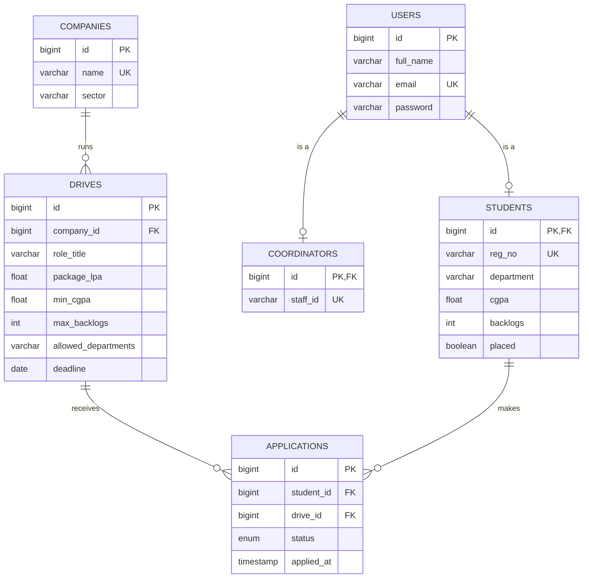

# Member 1: Data layer and Eligibility Service

Report chapters 5 (Database design), 6 (ORM and HQL) and 7 (Eligibility Service) come from this file.
Also use it to hand over to M2 and M3, and to prepare for the viva.

---

## 1. What Member 1 built

### placetrack-app (port 8080)

| File | What it is for |
| --- | --- |
| `pom.xml` | Maven build: Spring Boot 3.5.16, Java 17, web, Thymeleaf, JPA, validation, AOP, H2, BCrypt |
| `application.properties` | Port 8080, H2 file database, `ddl-auto=update`, `show-sql=true`, H2 console, eligibility URL |
| `PlacetrackApplication` | `main` method that starts the app |
| `model/User` | Abstract base account (id, name, email, BCrypt password). JOINED inheritance root |
| `model/Student` | Student account: regNo, department, CGPA, backlogs, placed |
| `model/Coordinator` | Coordinator account: staffId |
| `model/Company` | Recruiting company: name (unique), sector |
| `model/Drive` | A placement drive: company, role, package, min CGPA, max backlogs, departments, deadline |
| `model/Application` | One student's application to one drive, with a status |
| `model/ApplicationStatus` | APPLIED, SHORTLISTED, SELECTED, REJECTED, WITHDRAWN |
| `repository/*Repository` (5) | Database access: free CRUD, derived queries and 4 HQL queries |
| `service/CompanyService` | Company CRUD + rules: unique name, cannot delete a company that has drives |
| `service/DriveService` | Drive CRUD, open drives, rule: cannot delete a drive that has applications |
| `controller/HomeController` | Temporary: `/` goes to the drive list (M2 replaces it with login) |
| `controller/CompanyController` | Company pages: list, add, edit, delete |
| `controller/DriveController` | Drive pages: list, create, edit, delete |
| `config/AppConfig` | The shared `PasswordEncoder` (BCrypt) bean |
| `config/DataSeeder` | Fills an empty database with demo data on startup |
| `demo/HibernateSessionDemo` | SessionFactory / Session / Transaction demo with a rollback proof |
| `templates/fragments/layout.html` | Shared page head, navbar and message box |
| `templates/coordinator/*.html` (4) | Company list and form, drive list and form |

### eligibility-service (port 8081)

| File | What it is for |
| --- | --- |
| `EligibilityServiceApplication` | `main` method that starts the service |
| `EligibilityRequest` | JSON input: student's CGPA, backlogs, department + drive's criteria (validated) |
| `EligibilityResponse` | JSON output: `eligible` + list of reasons |
| `EligibilityService` | The 3 rules |
| `EligibilityController` | `POST /eligibility/check`, `GET /eligibility/ping` |

### Other files

| File | What it is for |
| --- | --- |
| `docs/report/schema.sql` | Database schema (spec submission item "database schema") |
| `docs/report/schema-and-sample-data.sql` | Schema + seed rows (spec item "sample records") |
| `postman/PlaceTrack.postman_collection.json` | Postman requests for the eligibility service (M3 adds the main-app API later) |
| `postman/PlaceTrack.local.postman_environment.json` | Postman variables `baseUrl` and `eligUrl` |

---

## 2. How to run

Start the eligibility service first, then the main app (two terminals, or two Run buttons in STS/IntelliJ).

```bash
cd eligibility-service && ./mvnw spring-boot:run
```
```bash
cd placetrack-app && ./mvnw spring-boot:run
```

| What | Where |
| --- | --- |
| Website | http://localhost:8080 (goes to the drive list until M2 adds login) |
| H2 console | http://localhost:8080/h2-console, JDBC URL `jdbc:h2:file:./data/placetrack`, user `sa`, empty password |
| Eligibility service | http://localhost:8081/eligibility/ping |
| Session demo | `cd placetrack-app && ./mvnw spring-boot:run -Dspring-boot.run.profiles=demo` |
| Tests | `./mvnw test` in each folder |
| Reset the data | Stop the app, delete the `data/` folder, start again |

Where is `data/`? It is created in the folder the app is started from. From a terminal inside `placetrack-app` it is
`placetrack-app/data/`. From IntelliJ it is usually the project root `data/`. If the H2 console says
"database not found", check which `data/` folder exists and adjust the JDBC URL.

---

## 3. Database design (report chapter 5)

### 3.1 ER diagram

GitHub renders this diagram automatically. For the report, paste it into https://mermaid.live and export a PNG.



### 3.2 Tables

| Table | Rows after first start | Key points |
| --- | --- | --- |
| `users` | 8 | Shared account fields. `email` unique |
| `students` | 6 | `id` is both the primary key and a foreign key to `users.id`. `reg_no` unique |
| `coordinators` | 2 | Same idea: `id` → `users.id`. `staff_id` unique |
| `companies` | 5 | `name` unique |
| `drives` | 5 | `company_id` → `companies.id` |
| `applications` | 4 | `student_id` → `students.id`, `drive_id` → `drives.id`, unique (`student_id`, `drive_id`) |

### 3.3 Relationships

- **Company 1 → many Drives.** Mapped with `@ManyToOne Company company` in `Drive`. Hibernate creates the
  `company_id` foreign key column in `drives`.
- **Student 1 → many Applications, Drive 1 → many Applications.** Two `@ManyToOne` fields in `Application`.
  `Application` is effectively the link between students and drives (a many-to-many with extra data:
  status and date).
- We only map the "many-to-one" side. No `@OneToMany` lists, so there are no loops when objects are turned into JSON,
  and nothing extra to explain.

### 3.4 ID generation strategy

All ids use `@GeneratedValue(strategy = GenerationType.IDENTITY)`. The database creates the number with an
auto-increment column: in the schema you can see `"ID" BIGINT GENERATED BY DEFAULT AS IDENTITY`.

| Strategy | How the id is made | Note |
| --- | --- | --- |
| **IDENTITY** (ours) | Auto-increment column in the table | Simple; the INSERT runs immediately on `save()` because Hibernate needs the id back |
| SEQUENCE | A separate database sequence object | Lets Hibernate get ids in batches; faster for bulk inserts |
| TABLE | A helper table that stores the next id | Portable but slow |
| AUTO | Hibernate picks one for the database | Less predictable |

---

## 4. Inheritance mapping

```java
@Entity @Table(name = "users")
@Inheritance(strategy = InheritanceType.JOINED)
public abstract class User { ... }

@Entity @Table(name = "students")
public class Student extends User { ... }
```

**JOINED**: the common fields go in `users`, each subclass has its own table with only its extra fields, and both rows
share the same `id`.

What Hibernate actually runs (copied from the console):

Loading applicants (a `Student` needs both tables, so it joins them):
```sql
select ... from applications a1_0
  join students s1_0 on s1_0.id = a1_0.student_id
  join users s1_1 on s1_0.id = s1_1.id
where a1_0.drive_id = ? order by s1_0.cgpa desc
```

`userRepository.findByEmail(...)` (it does not know yet if the user is a student or a coordinator, so it LEFT JOINs
both child tables and uses a `case` to pick the class):
```sql
select u1_0.id,
       case when u1_1.id is not null then 1 when u1_2.id is not null then 2 end,
       u1_0.email, u1_0.full_name, u1_0.password, u1_1.staff_id, u1_2.backlogs, u1_2.cgpa, ...
from users u1_0
  left join coordinators u1_1 on u1_0.id = u1_1.id
  left join students u1_2 on u1_0.id = u1_2.id
where u1_0.email = ?
```

Try it yourself in the H2 console:
```sql
SELECT U.ID, U.FULL_NAME, U.EMAIL, S.REG_NO, S.DEPARTMENT, S.CGPA
FROM USERS U JOIN STUDENTS S ON U.ID = S.ID;
```

| Strategy | Tables | Pros | Cons |
| --- | --- | --- | --- |
| SINGLE_TABLE | One table for all, plus a type column | Fastest, no joins | Many empty columns; child fields cannot be `NOT NULL` |
| **JOINED** (ours) | Parent table + one per child | Clean, normalised, `NOT NULL` works | Needs joins to read a child |
| TABLE_PER_CLASS | One full table per child, no parent table | No joins for one child | Polymorphic queries need `UNION`; ids must be unique across tables |

---

## 5. Every annotation on `Drive`, explained

| Annotation | Meaning |
| --- | --- |
| `@Entity` | This class is a database table |
| `@Table(name = "drives")` | Name of the table |
| `@Id` | This field is the primary key |
| `@GeneratedValue(strategy = IDENTITY)` | The database generates the id |
| `@ManyToOne(optional = false)` | Many drives belong to one company; a drive must have one (`company_id NOT NULL`) |
| `@Column(nullable = false)` | Column cannot be empty in the database |
| `@NotBlank`, `@DecimalMin`, `@DecimalMax`, `@Min`, `@NotNull` | Bean Validation: checked when a form is submitted (`@Valid`) and again by Hibernate before saving. Some also become database checks, e.g. `CHECK("MAX_BACKLOGS" >= 0)` |
| `@DateTimeFormat(iso = DATE)` | Lets the HTML `<input type="date">` value `2026-10-27` become a `LocalDate` |

Helper methods (not columns): `getDepartmentList()` turns `"CSE,IT"` into a list; `isOpen()` checks the deadline.

---

## 6. Repositories and HQL (report chapter 6)

`JpaRepository<Entity, Long>` gives `save`, `findById`, `findAll`, `deleteById`, `count` without writing any code.
That covers the CRUD requirement.

**Derived queries**: Spring reads the method name and writes the query.

| Method | Meaning |
| --- | --- |
| `findByEmail(email)` | find the user with this email |
| `existsByEmail(email)`, `existsByRegNo(regNo)` | does one exist already? (registration checks) |
| `findByNameIgnoreCase(name)` | company with this name, ignoring case (duplicate check) |
| `countByCompanyId(id)` | how many drives this company has (delete rule) |
| `countByDriveId(id)` | how many applications this drive has (delete rule) |
| `existsByStudentIdAndDriveId(s, d)` | has this student already applied? (M2's duplicate check) |

**HQL queries** (`@Query`). HQL is written with **class and field names**; Hibernate translates it to SQL with table
and column names.

| # | Query | HQL | SQL Hibernate runs | Used by |
| --- | --- | --- | --- | --- |
| 1 | Open drives | `select d from Drive d where d.deadline >= :today order by d.deadline` | `select ... from drives d1_0 where d1_0.deadline>=? order by d1_0.deadline` | Student drive list (M2), API (M3) |
| 2 | A student's applications | `select a from Application a where a.student.id = :studentId order by a.appliedAt desc` | `... where a1_0.student_id=? order by a1_0.applied_at desc` | My Applications (M2) |
| 3 | Applicants of a drive (**join fetch**) | `select a from Application a join fetch a.student s where a.drive.id = :driveId order by s.cgpa desc` | see section 4: one query joins `applications`, `students`, `users` | Applicants page (M3) |
| 4 | Applications per drive (**GROUP BY**) | `select d.company.name, d.roleTitle, count(a) from Drive d left join Application a on a.drive = d group by d.id, d.company.name, d.roleTitle order by count(a) desc` | `select c1_0.name, d1_0.role_title, count(a1_0.id) from drives d1_0 left join applications a1_0 on a1_0.drive_id=d1_0.id join companies c1_0 on ... group by ...` | Dashboard (M3) |
| 5 | Students per department (demo) | `select s.department, count(s) from Student s group by s.department` | `select s1_0.department, count(s1_0.id) from students s1_0 group by s1_0.department` | `HibernateSessionDemo` |

Why `left join` in query 4: a plain join would hide drives with zero applications. `left join` keeps them with count 0.

Why `join fetch` in query 3: without it Hibernate loads the applications first and then runs one extra query **per
student** (the "N+1 problem"). `join fetch` loads everything in one query.

**EAGER vs LAZY.** `@ManyToOne` is EAGER by default: loading a drive also loads its company. We kept the default so
pages never crash with `LazyInitializationException` (loading a LAZY field after the database session closed).
The cost is small extra queries, which is fine at our data size. LAZY loads the related object only when it is first
used, which is better for big data.

---

## 7. SessionFactory, Session, Transaction

| | What it is | How many | Thread-safe? |
| --- | --- | --- | --- |
| **SessionFactory** | Built once from all the entity mappings and DB settings. Expensive. Makes Sessions | One per database per app | Yes |
| **Session** | One unit of work with the database. Wraps a JDBC connection. Holds the **first-level cache** (an object loaded twice in the same session is fetched only once) | One per request or task, then closed | No |
| **Transaction** | Groups changes into all-or-nothing. `commit()` saves them, `rollback()` undoes them | One at a time per session | – |

In normal Spring code we never touch these directly. JPA's `EntityManagerFactory` **is** Hibernate's
`SessionFactory` underneath, the repositories use a Session for us, and `@Transactional` (M2) begins and commits or
rolls back the transaction.

`HibernateSessionDemo` does it by hand. Real output:

```text
===== Hibernate demo: SessionFactory -> Session -> Transaction =====
1. HQL GROUP BY, students per department:
     CSE = 2
     ECE = 1
     IT = 2
     MECH = 1
2. Companies before insert: 5
3. Companies after insert (inside the transaction): 6
4. tx.rollback() called
5. Companies seen by a NEW session: 5  -> the insert was undone
```

Steps: unwrap the `SessionFactory` from Spring's `EntityManagerFactory` → `openSession()` →
`beginTransaction()` → HQL query → `persist` a new company + `flush` (the INSERT is sent) → count is 6 →
`rollback()` → a new session counts 5, so the database never kept the row.

---

## 8. Eligibility Service (report chapter 7)

### 8.1 Contract

`POST http://localhost:8081/eligibility/check`

```json
{ "cgpa": 7.2, "backlogs": 1, "department": "IT",
  "minCgpa": 7.5, "maxBacklogs": 0, "allowedDepartments": ["IT", "CSE"] }
```

Response `200 OK`:

```json
{ "eligible": false,
  "reasons": ["CGPA 7.2 is below the required 7.5", "Backlogs 1 exceed the limit of 0"] }
```

| Rule | Fails when | Reason text |
| --- | --- | --- |
| Minimum CGPA | `cgpa < minCgpa` (equal passes) | `CGPA 7.2 is below the required 7.5` |
| Maximum backlogs | `backlogs > maxBacklogs` (equal passes) | `Backlogs 1 exceed the limit of 0` |
| Department | department not in the list | `Department MECH is not allowed (allowed: IT, CSE)` |

A missing or out-of-range field (e.g. no `cgpa`, or `cgpa: 11`) gives `400 Bad Request`, because of
`@Valid` + the annotations on `EligibilityRequest`. `GET /eligibility/ping` returns `{"status":"UP"}`.

### 8.2 Why it is a separate service

- It runs as its own process on its own port. It can be restarted, changed or scaled without touching the main app.
- It has no database; it only receives numbers and answers. The main app owns all data.
- The two apps share **no Java classes**. They only agree on the URL and the JSON shape (the "contract").
  That is the microservice idea: independent services that talk over the network.
- Anyone can call it directly (Postman, `curl`), which proves it is independent of the main app (use case UC23).

### 8.3 Monolith vs microservices

| | Monolith | Microservices |
| --- | --- | --- |
| Deployment | One app, deployed as a whole | Many small apps, each deployed on its own |
| Scaling | Scale the whole app | Scale only the busy service |
| Failure | One bug can take everything down | One service can fail while others keep working |
| Data | One shared database | Each service owns its data |
| Complexity | Simple to build and test | Network calls, timeouts, more moving parts |
| PlaceTrack | The main app is a monolith… | …with one job (eligibility) moved out as a microservice |

### 8.4 What happens when it is down (M2 builds this part)

The main app calls it with a 2 s connect and 3 s read timeout. If the service is down or slow, the call throws an
exception; M2 turns that into "Eligibility check unavailable, try later" and nothing is saved.

---

## 9. Tests

| Test | Type | Checks |
| --- | --- | --- |
| `EligibilityServiceTest` (5 tests) | Plain JUnit, no Spring | Equal CGPA passes; low CGPA, backlogs and department fail with the right text; all 3 can fail together |
| `EligibilityControllerTest` (2) | `@WebMvcTest` | Valid JSON → 200 with 2 reasons; missing field → 400 |
| `RepositoryTest` (4) | `@DataJpaTest` (temporary in-memory DB) | Open drives include today and skip expired; applicants sorted by CGPA; count per drive keeps a drive with 0; duplicate check |
| `PlacetrackAppTests` (2) | `@SpringBootTest` (whole app, in-memory DB) | Seed data counts are right; `findByEmail` returns a `Student` object (inheritance works) |

Total **13 tests, all passing**. Run with `./mvnw test`, or right-click `src/test/java` → Run Tests in the IDE.

---

## 10. Screenshots to take (save in `docs/screenshots/`)

| File | What to show |
| --- | --- |
| `m1-01-junit-main.png` | Test results for `placetrack-app` (all green) |
| `m1-02-junit-eligibility.png` | Test results for `eligibility-service` |
| `m1-03-h2-tables.png` | H2 console: the table list on the left |
| `m1-04-h2-inheritance.png` | H2 console: `SELECT ... FROM USERS U JOIN STUDENTS S ON U.ID = S.ID` with results |
| `m1-05-session-demo.png` | Console output of the demo profile (section 7) |
| `m1-06-companies.png` | Company list page |
| `m1-07-drive-form.png` | Create drive form with departments ticked |
| `m1-08-drives.png` | Drive list with Open / Closed badges |
| `m1-09-delete-refused.png` | Red message after trying to delete Zephyr Systems |
| `m1-10-postman-ineligible.png` | Postman: check request with reasons |
| `m1-11-postman-400.png` | Postman: missing field → 400 |

---

## 11. Notes for M2 and M3

- **Use these, do not rewrite them:** the entities, the repository methods above, `CompanyService`,
  `DriveService.findOpenDrives()` / `getById()`, the `PasswordEncoder` bean, the layout fragments
  (`head`, `nav`, `flash`).
- **Page skeleton**: copy `coordinator/companies.html`. Use the `flash` fragment and flash attributes `message` / `error`.
- **Seed accounts**: `coord1@placetrack.edu`, `student1@placetrack.edu` … `student6`, password `Pass@123`
  (full table in `PLAN.md` section 9).
- **Need more demo data?** Add it to `DataSeeder` and commit, so all three laptops get it. The seeder only runs on an
  empty database, so delete `data/` after pulling.
- **Changing an entity**: `ddl-auto=update` adds new columns automatically. It does **not** change an existing
  column's type. Hibernate stores `status` as an H2 `ENUM` column, so if you add a new `ApplicationStatus` value,
  delete `data/` and restart.
- `User.password` has `@JsonIgnore`, so M3's API never sends password hashes.
- M2 deletes `HomeController` and adds login; until then every page is open to anyone.

---

## 12. Viva questions and short answers

| Question | Answer |
| --- | --- |
| What is ORM? | Mapping Java objects to database tables so we work with objects and the library writes the SQL |
| JPA vs Hibernate? | JPA is the standard (annotations and interfaces); Hibernate is the implementation that does the work |
| Why JOINED? | No empty columns, child fields can be `NOT NULL`, tables stay normalised. Cost: a join to read a student |
| What SQL does JOINED produce? | A join between `students` and `users` on `id` (section 4) |
| Which ID strategy and why? | IDENTITY: simplest, the database auto-increments. SEQUENCE would be faster for bulk inserts |
| HQL vs SQL? | HQL uses class and field names and works on any database; SQL uses table and column names |
| What is `join fetch`? | Loads the related object in the same query; avoids the N+1 problem |
| EAGER vs LAZY? | EAGER loads related objects immediately; LAZY loads them on first use. `@ManyToOne` defaults to EAGER |
| SessionFactory vs Session? | One heavy, thread-safe factory per app vs. a short, non-thread-safe unit of work with a cache |
| What does a Transaction do? | Makes several changes all-or-nothing: commit or rollback |
| What does `ddl-auto=update` do? | Creates missing tables and columns from the entities at startup; never drops data |
| Where is CRUD? | `JpaRepository` gives it; the company and drive pages use create, read, update and delete |
| Why is eligibility a separate service? | Independent process and port, no shared classes, talks only via JSON; can change or fail on its own |
| What if it is down? | The call times out or is refused, the main app shows "try later" and saves nothing |
| How does `@Valid` give a 400? | Spring checks the annotations on the request record before the method runs and answers 400 if any fail |
| Why BCrypt? | Passwords are stored as a salted one-way hash, so a database leak does not reveal them |
| What is the seeder? | A `CommandLineRunner` that runs at startup and inserts demo data when the database is empty |
